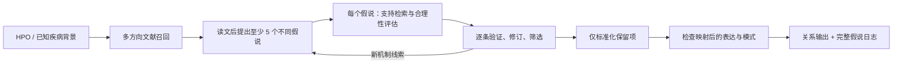

# 人类 HPO 文献先行研究框架（schema 2.0 / compact_v2）

## 研究顺序



继续使用 deep-life-sci 的 create_deep_agent + CodeInterpreterMiddleware + task 多轮架构。
root 通过 eval 直接制定并登记检索计划、执行查询、选择并获取论文、决定任务分派与下一步。
literature-scout 的独立循环已移除；原文阅读由假说专家执行。
workflow.py 校验阶段前提，不替 root 生成科学答案。
模型知识仍可补充机制推理，但整轮研究必须先接触文献、提出多个假说并验证，不能从第一个
参数知识答案直接跳到 CL/GO。smoke_test 同样执行完整顺序。
验证判断推断是否科学合理，不要求精确亚型的实验证明或唯一病因。合理的未验证推断以
inferred/conditional 输出；事实误读、矛盾或不合理外推由明确的 blocking_issues 阻止发布。

最终实验验证独立放在 experimental_validation，空 evidence 列表合法。已使用的实际研究通过
模型的 experimental_evidence 选择 evidence_ref，并判断 scope、study_type、species、
experimental_context、finding、effect；宿主填入 ClaimDraft 的原句/来源及最终定位元数据。
whole_claim 必须匹配完整主张与物种；局部机制、相关部位和动物模型资料通常只支持环节。
partial 不自动阻止合理推断，但不能隐藏来源解释错误。relations.jsonl 汇总所有接受关系。
模型的 cell、abnormality、phenotype_link 三栏提供科学解释，适用假设只填写一次。
assembly.py 生成展示链的 source/target、起点、scope/basis 和终点，模型不抄写这些字符串。
这些字段表示解释的展示顺序，不替代科学推理，也不自动宣称因果。
模型接口和丰富的存储记录分开：model_*.schema.json 描述紧凑提交，其余记录 Schema 校验宿主输出。
输出格式与科学合理性仍独立；模型只负责科学内容和证据选择，程序负责可确定的结构与元数据。
ToolStrategy 的格式反馈统一为 invalid_format + issues(code/path/message/expected/actual)。
重复同一未修复字段错误有界退出，保留失败提交；仅修改其他文字不会重置该错误计数。
实时审计记录 submission_validation_failed，避免叶节点内部校验失败被 errors=[] 掩盖。

默认最低要求为 5 个检索方向、5 篇初检文献、5 个假说，分别由 min_discovery_directions、
min_discovery_papers、min_hypotheses 控制。至少 3 类检索视角；假说不能只是同一句话改写。
数量/字面重复有程序校验，科学上的区分度仍需要生成与评估模型判断，不能仅凭计数保证质量。

## 子智能体分工

| 子智能体 | 输入与职责 | 工具与最终提交 |
| --- | --- | --- |
| hypothesis-generator | 广泛召回之后读取实际来源，结合模型知识提出多个不同细胞/机制假说 | read_document、find_in_document；最后 SubmitHypotheses |
| hypothesis-evaluator | 读取某一假说的支持检索结果，结合原文、模型知识和适用假设判断保留、排除或暂不确定；不要求排除其他机制 | read_document、find_in_document；最后 SubmitAssessment |
| ontology-normalizer | 只对保留项做自由文本到 CL/GO 的术语选择及 ID/规范 label 校验 | search_ontology、get_ontology_term、可选 read_evidence；最后 SubmitMapping |
| evidence-reviewer | 检查映射后是否改变主体、过程、方向、直接/推理模式等 | 宿主注入当前结论、假说评估及来源；最后 Review |

root 只传 ID、开放问题和已有反馈，不把期望的细胞/GO 答案写进 focus。
旧 evidence-extractor / evidence-reasoner 仅保留为隔离组件测试接口，不注册在正式研究流程中。
所有模型共享同一个请求限流器，默认并发 3；术语默认逐个处理。

## 背景工具：从 HPO 取得相关疾病信息

```js
var background = await tools.getPhenotypeBackground({
  ancestor_depth: 3, limit: 10, offset: 0
});
```

background.py 读取版本化 HPO 本体和 phenotype.hpoa 的本地 SQLite 索引，返回：

- 当前术语的名称、定义、同义词、父级与距离；
- 疾病 ID/名称、原始注释、证据代码、来源、频率、发病年龄和部分共现表型；
- exact 与 ancestor_background 匹配范围；
- 单独记录的否定/零频率注释、来源版本和哈希。

父级表型的疾病关联只作为背景，不自动成为精确目标术语的疾病注释。NOT、零比例/百分比、
HPO 的 Excluded 频率项不进入正关联；Excluded ID 从本体的频率标签解析，Obligate 仍是正注释。
支持 offset/next_offset 分页，以及 disease_query 按名称/ID 缩小范围，避免把第一条疾病当作诊断。
有明确的输入疾病背景时应优先考虑；未指定疾病时从多个相关背景扩展检索。

HPO 标准字段说明见[官方 phenotype.hpoa 文档](https://obophenotype.github.io/human-phenotype-ontology/annotations/phenotype_hpoa/)。
本项目仅接受 HP 输入；动物实验作为人类机制推论的支持材料，保留实际研究物种和外推条件。

## 多方向召回及搜索记录

root 先通过 tools.registerDiscoveryPlan 登记计划，plan.directions 各有 direction_id、label、kind、rationale、queries。
kind 可覆盖表型、疾病、病理、发育、细胞、分子、模型或反证视角；至少 3 类，避免所有查询都锁定
同一个预设细胞。完全相同的查询不能冒充不同方向。

```js
await tools.pubmedSearch({
  term: query, retmax: 10, direction_id: directionId, intent: "discovery"
});
```

每个方向至少执行一次 retmax>0 的召回，零命中也记录；retmax=0 只算计数探测。
root 在每轮有界检索后检查结果与状态，初检缺口已清除就派发 hypothesis-generator；
不等待包含未来任务的 pending.workflow 全部清空，不盲目重复获取缺失摘要。
每条假说的支持检索由 root 直接调用相同工具，并在获取相关来源后派发 evaluator；反证检索可选。
工具返回 query_id、数量、PMID、查询翻译和警告。fetchAbstracts 批量暂存摘要，fetchFullText 按需升级。
只有标题/PMID 不算读过论文；hypothesis-generator 必须实际读取所需数量的不同来源。

offline 模式使用 searchLocalDocuments：在已暂存资料中做字面短语匹配，并记录同样的方向/目的字段。
它不解释 PubMed 布尔语法，不访问网络，也不能凭空提供没有加载的文献。

## 假说池及来源

```js
var pool = await dispatch("hypothesis-generator", {});
```

模型的 HypothesisProposal 包含 title、direction_id、cell_text、process_text、direction、mechanism、
why_distinct、seed_evidence_refs 和可选 model_knowledge_basis。
宿主从该子任务读过的片段生成 HypothesisDraft.seed_evidence 原句和来源，偏移不由模型填写。
说明该假说如何受文献启发，不等于完整机制已经被证明。此时不输出 CL/GO。

SubmitHypotheses 校验数量、方向覆盖、明显重复和引句；合法后结束该子任务。宿主生成 hypothesis_id，
保存最初提案、原文哈希/偏移、提出时的搜索序号，status=proposed。
未知/未读片段返回 evidence.ref 和字段位置，不能用新增无关论文或编造 ID 修复。
首次或实际修改后的提交会重置连续重读计数，保留有界的引用校对机会；相同失败提交仍会被拦截。
同来源仅改 focus 的失败重派仍被拒绝；正式模式不使用 repair_submission=true。
如果资料确实不够，可以以较少候选和非空 limitation 结束子任务；候选仅保存为未注册尝试，
不开放标准化。root 必须扩展资料或诚实返回未完成，不能靠凑数越过要求。

后续发现新机制时可传 extend_pool=true，追加至少一个新假说；不覆盖原池，并重新形成待验证任务。
同一细胞可以有不同机制假说，但不能只改解释措辞。所有新增候选也要评估后才能继续标准化。

## 逐条验证与保留

```js
await tools.pubmedSearch({term:supportQuery, retmax:10, hypothesis_id:hid, intent:"support"});
// 获取相关命中文献后：
var assessed = await dispatch("hypothesis-evaluator", {hypothesis_id:hid});
```

评估器的 ScientificAssessment 提交 decision、rationale、可选支持/反证片段和科学修订理由。
保留项的 claim 只有 cell、abnormality、phenotype_link 三个科学块、一次性 assumptions、
可选 disease_context（假说适用的疾病限定，不是输入诊断）和实验选择。
其他组织、发育和物种适用性写入 assumptions。不能由程序补齐缺失的科学理由或假设。
程序生成 hypothesis_id、目标 species/taxon、来源列表、推理步骤和保守 inferred provenance。
选中片段必须属于该任务的已读范围；同一篇论文的摘要与全文是不同的不可变片段。
本体标签和审核派生字段也不再由模型重复填写。提交前程序无损搬移已知错位字段、合并相同重复项，
冲突不覆盖，缺失科学解释不补造；搬移前后内容和路径进入审计。格式错误按模型的实际层级报告。
片段展示为任务内 E1/E2 短编号，内部不改文献、哈希、位置身份；失败输入保存编号映射，
后续补充/重评恢复原映射后才给新片段分配编号。未知/未读引用仍严格拒绝。
缺失科学内容或引用选择错误返回 needs_reasoning/invalid_reference，携 failure_id 可在原评估器
通过 mode:"complete_reasoning" 补充一次指定字段。程序冻结原决定与其他科学内容，不进行整条调研重试。
有冲突时返回 field_conflict/scientific_conflict；网络和空响应返回 transport_error，保留补充机会。
只有需要科学重新判断时，显式传 `mode:"reevaluate",reassessment_reason:"具体理由"`；
宿主保留失败科学输入和已读依据，不能把格式/执行失败当作科学反证。
旧的 mode:"repair" / SubmitAssessmentRepair 仅在隔离的丰富记录兼容接口中保留，不进入正式调研提示词。
direction 在生成、评估、标准化与审核中均表示所填细胞过程/质量的方向，不要求与宏观表型同向。
以支持证据、推理连贯及适用假设合理为保留标准，不要求专门检索反证或排除其他机制。
证据的 whole_claim/contradicts 标签不直接否决；评审需判断已读结果是否确实否定适用条件下的关键前提。
其他模型的负面结果或未报告表型可以作为适用限制。缺少实验证明、并存异常及替代机制本身不阻断。
experimental_validation 的状态描述已记录的实验发现，不等于整条推论的科学裁决或因果证明。

支持目的的成功检索必须发生在假说注册之后；初检不能直接冒充针对该假说的验证。
零命中是搜索限制，不证明假说成立/不成立。可以复用初检中已读的相关论文，但要记录新的验证检索。
调用评估模型前，支持检索及已获取的可选挑战来源分别最多交付一个正文片段，合并重复来源。
支持检索命中但缺少已获取来源时返回 needs_sources 和所需 PMID/查询，不消耗模型调用；
可选挑战来源未获取不阻止评估，只有实际交付正文才计为已读。
命中资料时，至少阅读相关返回来源才能保留，不能只看元数据。资料无法取得时记录限制并诚实结束。

SubmitAssessment 的模型提交经程序组装为 HypothesisAssessment 与最终 ClaimDraft。
模型原始 model_output 和宿主 output 分别进入审计；三个决定都存入日志：

- retain → retained：形成可追溯的 claim_id，尚未开放单独抢先标准化；
- reject → rejected：保留排除理由，无最终 claim；
- inconclusive：保留不确定性，无最终 claim。

改动细胞、过程或方向时，程序比较前后内容并引用模型 rationale 生成 revision_note；再次评估保留旧 assessment_history，旧 claim 退休，
相同 claim 的旧审核也失效。保留项不能仅通过 retireClaim 被删除来绕过最后的标准化要求。
已有文献和模型知识可以共同支持推理，不要求每个知识前提都单独补引文。

## 最后才标准化

程序检查整个假说池已经评估，而且当前 claim_id 对应 retained 假说。少于最低假说数、
仍有 proposed 假说、或目标不是保留项时，normalize/review 均被拦截。

SubmitMapping 的模型只选 CL/GO ID、置信度和理由；宿主查索引生成规范标签，验证命名空间、
存在性和废弃状态。合法即结束子任务，不负责重新要求文献证明。
不能把更换细胞身份或改变否定范围隐含在术语映射里；需要时回到假说评估明确修订。

最终记录保留 cell_evidence_mode、link_evidence_mode、knowledge_source 和 reasoning_steps。
正式假说预测由宿主保守标为 inferred，实际实验是否支持完整结论另存；历史 direct
记录与组件接口仍按原有严格条件校验，不自动重判或升级。
任一关系维度有推断，整体为 inferred；模型知识不伪装成论文发现。引用仍逐字校验。
“某过程不由某结构介导”不等于该过程 absent，这一点在验证和最终审核提示词中明确要求。

## root、输出和验证

交互说明在运行时由 prompts.build_root_prompt(settings) 组装，并由 agent.py 直接传入
create_deep_agent 的 system_prompt。模型第一轮请求就收到它，不需要自行打开本 Markdown。
内容包括阶段要求、工具/子智能体参数、返回对象字段、ID 用途、错误到下一步动作的对应关系，
以及该次运行实际的最少假说数、召回数量、并发和预算。本文是同一契约供人查阅的说明。

root 通过 eval 的 tools.camelCase 和 task 派发；子智能体直接使用 snake_case 工具。
任务返回固定 JSON 字符串/对象，不传动态 responseSchema：

```js
var dispatch = async (name, payload) => {
  var r = await task({subagentType:name,description:JSON.stringify(payload)});
  return typeof r === "string" ? JSON.parse(r) : r;
};
```

getResearchState 返回背景、计划、假说池、查询摘要、待处理项和预算。正文在宿主中，通过定位符读取。
另外返回宿主生成的 summary_counts。Root 的 ResearchCompletion 只提交科学摘要、stop_reason 和 limitations，
宿主添加准确 state_version 和计数。审核模型提交各科学维度的 status/reason，宿主派生原有 Review 字段与发布范围。
ResearchCompletion 不能越过 pending.workflow。错误保留为错误，不解释成科学上的阴性发现。
每步消息进入 events.jsonl；每次任务后保存 session.json/audit.jsonl；输入在调用时深拷贝，
避免后续检索/评估修改历史模型输入的审计记录。

hypotheses.jsonl 保存完整假说池、原始线索、验证查询、决定和历史；claim.hypothesis_id 连接最终关系。
只有保留项能生成标准化关系；被排除或不确定的假说仍可独立分析。
HPO 注释索引、CL/GO 索引、提示词、代码和设置均进入运行指纹，旧归档不改写。

离线验证使用真实 Deep Agents/QuickJS 编译图和可控模型替身，包含 5 个假说的完整流程、
早期标准化拦截、仅保留项输出、支持检索与可选反证查询、来源实际阅读、数量不足的退出，以及 HPO 注释范围/否定处理。
旧阶段组件测试显式使用 component_test 隔离新流程；该模式不能通过 CLI 用于正式研究。
legacy_prompts.py 专用于兼容组件/回放；prompts.py、运行时工具 Schema 和 model_contract=compact_v2
共同定义当前正式接口。存储版本 2.0 与模型接口版本分开标注，旧文件保留原值且不改写。
model_scientific_supplement.schema.json 只用于 complete_reasoning；模型只提交指定科学字段，
完整合并结果仍通过正式 ScientificAssessment 与丰富记录校验。Root 汇总、完成页和导出共用有效结论过滤。
