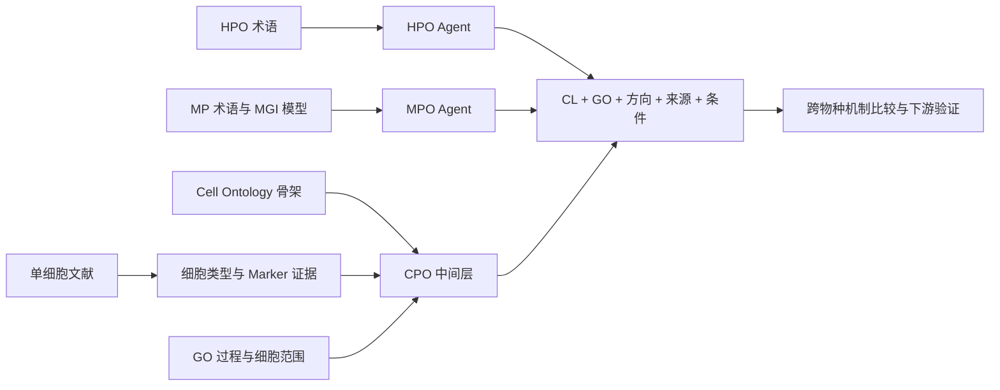

# Universal Human Phenotype Ontology (UHPO)

通过细胞表型中间层 **CPO（Cellular Phenotype Ontology）**，连接人类表型 HPO、哺乳动物表型 MPO 与细胞机制证据。

本仓库整理截至 **2026-10-11** 的研究代码。当前术语映射主线为独立的 HPO/MPO 文献研究 agent；下游模块保留可审查的探索与验证实现。这里只发布代码、配置、测试和小型合成示例，暂不发布真实数据、模型权重、索引或运行产物。



## 从哪里开始

| 工作部分 | 代码入口 | 当前状态 |
| --- | --- | --- |
| **术语与 CPO 映射** | [CPO_mapping](CPO_mapping/README.md)：`hpo-agent`、`mpo-agent`、`aligment_test` | 当前主线；两端独立调研，配对测试仍为先导工作 |
| **CPO 构建** | [CPO_construction](CPO_construction/README.md)：CL 骨架、单细胞文献 Marker、GO–CL 连接 | 保留当前各组件及重建入口 |
| **下游任务与验证** | [下游导航](docs/downstream.md)：候选基因排序、小鼠模型排序、CPO 比较矩阵、单细胞验证 | 探索性实现与初步结果说明 |
| **历史 MPO–HPO 映射** | [legacy/MPO_HPO_mapping](legacy/MPO_HPO_mapping/README.md)：Poincare 结构嵌入与晚融合 | **方法落后，已弃用，不采用，待更新** |

## 目录

```text
.
├── CPO_mapping/                 # 当前 HPO / MPO agent 与先导对接
├── CPO_construction/            # 构建导航及 CL 骨架源码
├── marker_literuture/           # 文献 Marker 提取、名称标准化、特征分析
├── CPO_generize/                # GO/CL 构建组件及共享研究工作区
│   ├── GO_link/                 # GO-BP 范围判定及精确细胞链接
│   ├── GO_function/             # GO 功能基因导出
│   ├── cell_marker/             # 细胞 Marker 导出
│   ├── celltype_configure/      # 语义召回及 SCEA 证据
│   ├── UHPO/                   # 既有四阶段流程整合实现
│   ├── mission3/               # 具体小鼠基因型优先级排序
│   ├── mission4/               # CPO 比较、疾病模型与基因预测
│   └── MPO_HPO_mapping_v4/      # 无训练语义/CPO 基准，探索性验证
├── mission3/                    # 较新 CellPhenoRank 与单细胞验证
├── legacy/MPO_HPO_mapping/      # 已弃用结构嵌入方法
├── docs/                        # 数据、结果边界、来源和验证说明
└── scripts/check_repository.py  # 代码快照与敏感信息检查
```

为保持既有导入和相对路径，`CPO_generize`、`marker_literuture` 和 `aligment_test` 保留原拼写。根目录 `mission3` 是较新的 CellPhenoRank；`CPO_generize/mission3` 是具体小鼠模型排序，二者是不同任务。

## 安装与运行

各模块独立安装，Python 版本和依赖以自己的 `pyproject.toml` / `requirements.txt` 为准。Agent 需要 **Python 3.12+**。

```bash
python3.12 -m venv .venv
source .venv/bin/activate
python -m pip install -e ./CPO_mapping/hpo-agent -e ./CPO_mapping/mpo-agent
cp .env.example CPO_mapping/.env
```

在本地 `.env` 配置模型服务后，按 [HPO Agent](CPO_mapping/hpo-agent/README.md) 和 [MPO Agent](CPO_mapping/mpo-agent/README.md) 建立索引并运行。文献调研可能访问网络及产生模型费用；测试使用替身，不代表完成了真实调研。`offline` 仅关闭文献网络，仍可能调用模型。

无真实数据时，可以先运行 [小鼠模型排序合成示例](CPO_generize/mission3/README.md#quick-start) 和已有离线测试。完整数据准备见 [数据指南](docs/data.md)。

```bash
python3 scripts/check_repository.py
python -m pip install pytest pytest-asyncio
cd CPO_mapping/hpo-agent
python -m pytest
```

## 如何解释结果

CPO 关系保留细胞、过程、方向、证据来源及适用条件。共享 CL/GO ID 不足以证明两个术语等价；缺少证据不等于阴性；小鼠模型的结论必须保留基因型、背景和实际研究物种。

本次只同步代码，没有用新 agent 重新生成下游数据。因此，现有下游报告中的数值对应原先固定的数据快照，不能视为当前 agent 的端到端效果。初步结果与限制见 [研究状态](docs/status.md)。

源码来源与取舍见 [同步说明](docs/provenance.md)，实际检查见 [验证记录](docs/validation.md)：本次有 **574 项离线测试通过**，并运行了合成示例与发布内容检查。

第三方代码及数据分别遵循其原许可，已保留 agent 的上游许可和 notices；本次未替作者新增统一开源许可证。
